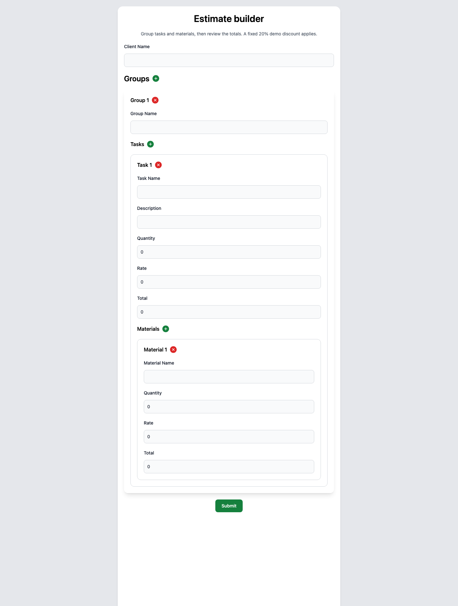

# Nested estimate form

A React and TypeScript demo for editing a client estimate with **groups → tasks → materials**. Add or remove rows at each level, validate required fields and numeric values, and review task/material totals with a fixed 20% demo discount.



The screenshot shows the actual local form. It contains no client data and does not demonstrate a saved estimate or connected billing system.

## Try a small estimate

```sh
npm ci --ignore-scripts
npm start
```

Open [the form](http://localhost:3000). Enter a synthetic client and group, add a task description, then fill quantity and rate for both the task and at least one material. Totals update as you edit. Submit to see the summary; **Back** returns the submitted values for further editing.

For a task with quantity `2` and rate `50`, plus a material with quantity `3` and rate `10`, the summary is:

| Calculation | Amount |
| --- | ---: |
| Task total | 100 |
| Material total | 30 |
| Net total | 130 |
| Fixed demo discount | 20% |
| Grand total | 104 |

No currency or tax rules are configured. The 20% rate is deliberately a fixed example, not a pricing engine.

## Design worth looking at

`DynamicForm` owns React Hook Form state. Nested `useFieldArray` components manage groups, tasks and materials. Yup defines required fields, minimum values and finite-number checks; input components connect labels and error messages to the correct field path.

`useWatch` derives each line total from quantity × rate. Updates are written only when the derived value changes, avoiding redundant watch/update cycles. Inputs that overflow a finite line total are rejected. Number inputs allow decimal steps while the schema retains its minimum quantity and nonnegative rate rules.

`FormResult` reads submitted data from React Router navigation state. Direct navigation without that state shows an empty-state action rather than an apparently valid zero-value estimate. Memoized summaries depend on the current submitted data.

## Persistence and scope

This is a browser-only prototype: there is no backend, account system, database, payment flow or document export. Form data travels in browser history/navigation state; it is not a durable saved estimate. Do not use real client data for a public demonstration.

Amounts use JavaScript floating-point arithmetic and are not a production money representation. A real estimating product would need deliberate rounding, currency, pricing authorization and persistence rules. Large field arrays and data migration are not covered by this small demo.

## Verification

```sh
CI=true npm test -- --watchAll=false --runInBand
npm run build
```

Nineteen tests pass across nested editing, live total updates, required-field errors, submission, result rendering, empty results, return-to-edit behavior and nonfinite/overflow rejection. The production build includes TypeScript and the project's formatting checks. The desktop Chrome screenshot was inspected; no mobile-browser verification is claimed.

The existing Create React App/Babel, testing-library deprecation and Jest open-handle warnings remain. React Hook Form, Yup and Tailwind retain their existing dependency versions. No license file is present.
