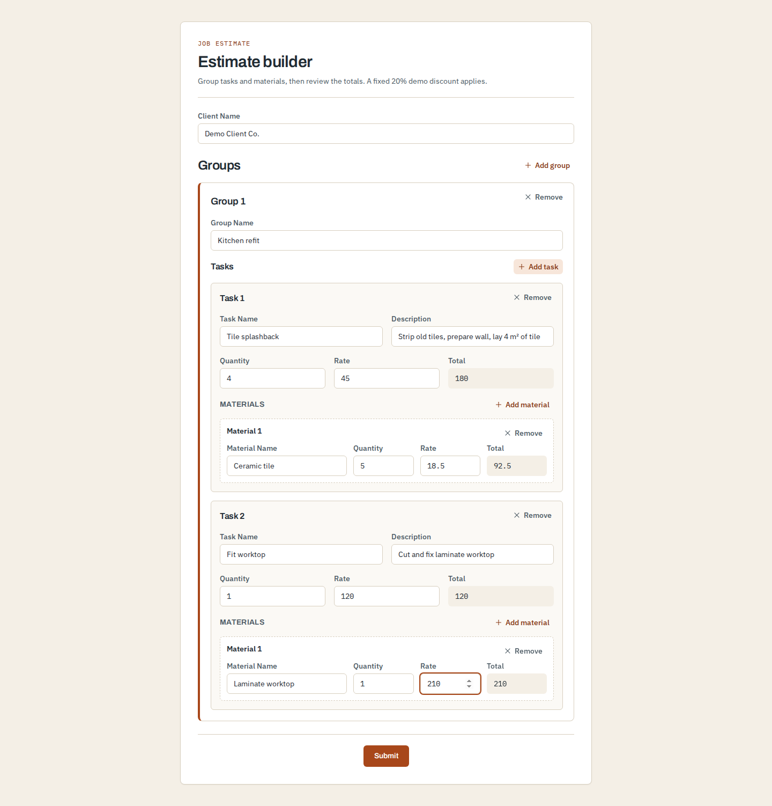
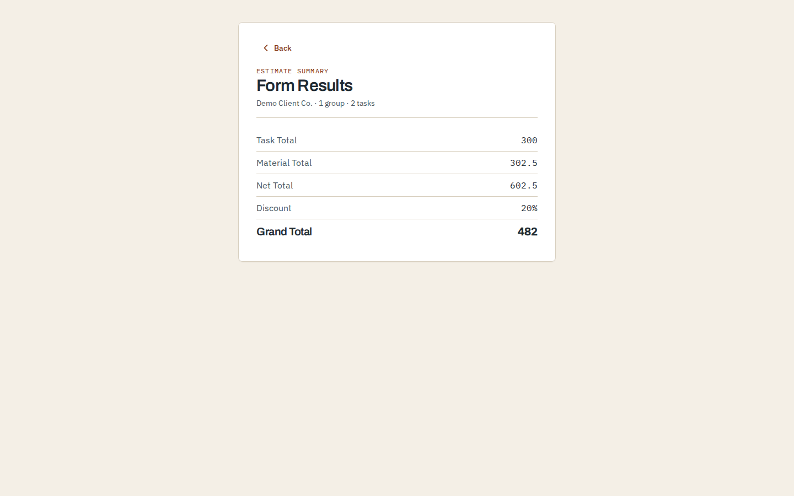
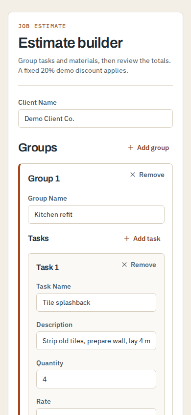
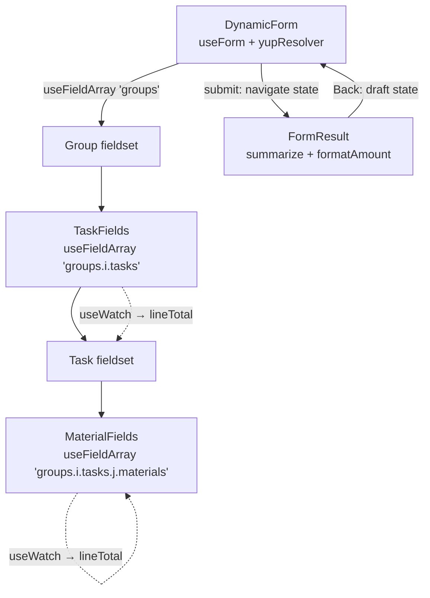
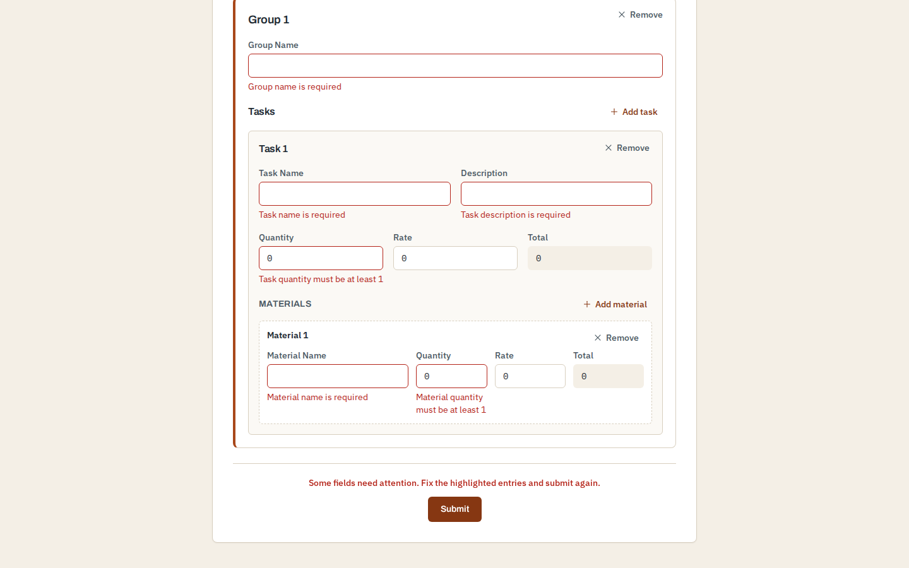

# Nested estimate form

A React and TypeScript demo of a three-level dynamic form: an estimate holds **groups**, each group holds **tasks**, and each task holds **materials**. You can add or remove rows at every level, line totals update as you type, and the yup schema validates the whole tree before a summary page shows task, material, net and discounted totals.

It is meant as a worked example of `useFieldArray` nested two levels deep, with validation messages that reach the right field, the right row and the right list.



## Run it

**With Docker** (nothing else needed):

```sh
docker build -t estimate-form .
docker run --rm -p 8080:80 estimate-form
```

Then open <http://localhost:8080>. The image only builds if lint, the test suite and the production build all pass, so `docker build` doubles as a full check. The runtime stage is nginx serving the static bundle.

**With Node** (Node 22 via `.nvmrc`; `engines` accepts 22.22+ or 24.15+):

```sh
nvm use          # or any Node 22 install
npm ci
npm run dev      # http://localhost:3000
```

| Script | What it does |
| --- | --- |
| `npm run dev` | Vite dev server on port 3000 |
| `npm test` | Vitest with jsdom, run once |
| `npm run lint` | ESLint (typescript-eslint, react-hooks, Prettier) |
| `npm run build` | `tsc --noEmit`, then a Vite production build into `dist/` |
| `npm run preview` | Serve `dist/` on port 3000 |

No environment variables or backend are involved.

## A small estimate

Enter a client and a group name, then fill one task with quantity `2` and rate `50`, and its material with quantity `3` and rate `10`. Submit, and the summary shows:

| Line | Amount |
| --- | ---: |
| Task Total | 100 |
| Material Total | 30 |
| Net Total | 130 |
| Discount | 20% |
| Grand Total | 104 |

**Back** returns to the form with the submitted values still filled in.

<p>
  
  
</p>

## How it is put together



- **One form, three field arrays.** `DynamicForm` owns the React Hook Form instance and shares it through `FormProvider`. `TaskFields` and `MaterialFields` each call `useFieldArray` on their own path (`groups.0.tasks`, `groups.0.tasks.1.materials`), so each list adds, removes and keys its own rows.
- **Derived totals.** Each list watches its rows with `useWatch` and writes `quantity × rate` back into the read-only Total field, but only when the value actually changes, so the watch loop settles. `src/lib/totals.ts` holds that rule (rounded to cents, so `3 × 0.1` shows `0.3`) and the summary arithmetic.
- **Validation in one schema.** `src/schemas/formSchema.ts` mirrors the nesting: required names and descriptions, quantity at least 1, rates and totals not negative, a plain message when a number field is emptied, a guard against non-finite numbers and products that overflow, and "at least one" rules for every list. The resolver files list-level errors under `.root`, which is where each list renders its message.
- **Accessible structure.** Every group, task and material is a `<fieldset>` named by its legend ("Task 2"). Inputs point to their error text with `aria-describedby` and set `aria-invalid`. Remove buttons are named per row ("Remove task 2"). After a failed submit, focus jumps to the first invalid field, and a summary line sits above the button.
- **Results without a backend.** The submitted estimate travels in React Router navigation state. Opening `/results` directly shows an empty state with a link back to the form, not a page of zeros.



## Tests

40 tests across six files run with Vitest and Testing Library:

- `NestedFieldArrays.test.tsx` uses user-event and named fieldsets to cover per-group task lists, renumbering after a middle row is removed, per-row material totals, a multi-group submission and its summary, blur-time and post-submit validation, and errors confined to the incomplete group.
- `ValidationMessages.test.tsx` covers the list-level messages and emptied number fields.
- `DynamicForm.test.tsx` and `FormResult.test.tsx` cover rendering, totals, submission, the empty results page and returning to edit.
- `formSchema.test.ts` and `totals.test.ts` test the schema and arithmetic directly.

## Scope and limits

This is a browser-only prototype: no accounts, storage, export or currency handling. Form data lives in browser history state and is gone once the tab closes. Use made-up client data.

Amounts are JavaScript numbers. Line totals are rounded to cents, but there is no tax, currency or rounding policy beyond that, and the 20% discount is a fixed constant (`DISCOUNT_RATE`), not a pricing rule. Very long estimates have not been profiled.

## License

[MIT](LICENSE)
